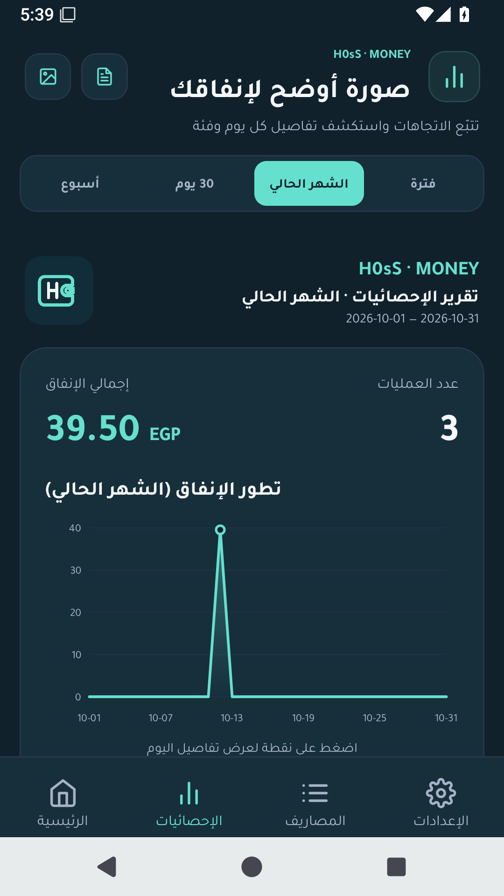

<div align="center">
  
  <br /><br />
  <strong>إدارة مالية يومية، بواجهة عربية واضحة.</strong>
  <p>سجّل مصروفاتك، تابع دخلك وحساباتك، وافهم أين تذهب أموالك.</p>
  <br /><br />
  <a href="#من-داخل-التطبيق">صور التطبيق</a> &nbsp; · &nbsp;
  <a href="#كل-ما-تحتاجه-لمتابعة-أموالك">الميزات</a> &nbsp; · &nbsp;
  <a href="#ابدأ-في-أربع-خطوات">البداية</a> &nbsp; · &nbsp;
  <a href="https://github.com/H0sSs/H0sS-Money/archive/refs/heads/main.zip">تحميل السورس</a>
  <p><sub>السورس 1.2.3 &nbsp; | &nbsp; Android 7+ &nbsp; | &nbsp; واجهة عربية &nbsp; | &nbsp; وضع فاتح وداكن</sub></p>
</div>

---

## من داخل التطبيق

<table>
  <tr>
    <th align="center">الرئيسية والتسجيل</th>
    <th align="center">الإحصائيات والتقارير</th>
    <th align="center">المظهر والحماية</th>
  </tr>
  <tr>
    <td align="center"></td>
    <td align="center"></td>
    <td align="center"></td>
  </tr>
</table>

<sub>صور فعلية من الإصدار الحالي على محاكي Android، باستخدام بيانات تجريبية.</sub>

## كل ما تحتاجه لمتابعة أموالك

### تسجيل أسهل، ومراجعة أوضح

أضف المصروف يدويًا أو اذكر عدة أصناف في تسجيل صوتي واحد. راجع أسعارها وفئاتها وحساباتها وتواريخها قبل حفظ القائمة، ثم عدّل وابحث وفلتر أو تراجع عن آخر حذف.

### حساباتك وإيراداتك في مكان واحد

أنشئ حسابات بأرصدة افتتاحية، وسجّل الدخل والتحويلات بينها. تابع الديون والسداد الجزئي، وجهّز المصروفات الأسبوعية والشهرية المتكررة.

### أرقام تساعدك على فهم إنفاقك

اختر أسبوعًا أو 30 يومًا أو شهرًا تقويميًا أو فترة مخصصة. راجع توزيع الفئات ومقارنة الأشهر، وحدّد ميزانيات وهدفًا شهريًا مع تنبيهات الإنفاق. صدّر صورة للإحصائيات أو PDF عربيًا بتفاصيل العمليات والإيرادات والصافي.

### تجربة تناسبك وتحافظ على بياناتك

واجهة موحّدة بخط Tajawal العربي، مع بداية متناسقة للشعار والخلفية. اختر الوضع الفاتح أو الداكن وشعارك داخل التطبيق. فعّل قفل البصمة أو رمز الجهاز، واحتفظ بنسخة JSON أو اختر حساب Google الموجود على هاتفك لرفع نسخة يدويًا إلى Drive بعد تفعيل إعداد المشروع من مالك التطبيق.

## ابدأ في أربع خطوات

| الخطوة | ما تفعله |
| --- | --- |
| **01 · جهّز حسابك** | اختر العملة، وأضف حساباتك وفئات المصروفات من الإعدادات. |
| **02 · سجّل حركاتك** | أضف المصروفات والإيرادات، وراجع كل عملية قبل حفظها. |
| **03 · تابع الصورة كاملة** | افتح الإحصائيات، واختر الفترة، وصدّر التقرير المناسب. |
| **04 · احتفظ بنسخة** | صدّر بياناتك دوريًا من قسم النسخ والبيانات. |

## التسجيل الصوتي والذكاء الاصطناعي

من **الإعدادات ← الذكاء الاصطناعي**، أدخل مفتاح المزوّد واختر خدمة الصوت والتحليل.

| المزوّد | تحويل الصوت | تحليل المصروف |
| --- | :---: | :---: |
| **Gemini** | ✓ | ✓ |
| **OpenAI** | ✓ | ✓ |
| **Z.ai · GLM-5** | عبر Gemini أو OpenAI | ✓ |

عند اختيار Gemini للصوت والتحليل معًا، يستخدم التسجيل **طلبًا واحدًا**. الصوت يحتاج الإنترنت ومفتاحًا صالحًا وحصة متاحة لدى المزوّد. راجع النص والأصناف قبل الحفظ؛ نتائج الذكاء الاصطناعي قد تحتاج تصحيحًا أو إضافة صنف مفقود.

## التحميل والتحديث

**ARM64** أصغر حجمًا للأجهزة التي تدعم `arm64-v8a`. **النسخة الشاملة** تدعم أيضًا `armeabi-v7a` و`x86` و`x86_64`. النسختان تقدمان الميزات نفسها.

ملفات 1.2.3 الموقعة جاهزة؛ نشر APK العام ينتظر إعداد مفتاح التوقيع الخاص على GitHub. نسخ 1.2.2 والأقدم تستخدم شهادة تطوير عامة.

**الانتقال إلى 1.2.3 بتوقيع خاص:** صدّر JSON واحفظه خارج التطبيق، ثم احذف النسخة القديمة وثبّت الجديدة واسترجع JSON. مفاتيح AI تحتاج إدخالها من جديد. التحديثات التالية بنفس التوقيع لا تتطلب حذف التطبيق.

[نتائج اختبارات 1.2.3](docs/QA-1.2.3.md) · [عينة PDF فعلية](docs/report-sample-1.2.3.pdf)

<details>
<summary><strong>البيانات والخصوصية</strong></summary>

البيانات المالية محفوظة محليًا في SQLite. مفاتيح API محفوظة في SecureStore ولا تدخل في النسخ الاحتياطية. التسجيلات والنصوص تُرسل إلى مزوّد AI الذي تختاره، ونسخ Google Drive تُرفع عند طلبك.

الحسابات تستخدم عملة العرض نفسها دون تحويل أسعار صرف. التكرار التلقائي يُعالج عند فتح التطبيق أو العودة إليه.

</details>

<details>
<summary><strong>التطوير والمساهمة</strong></summary>

Expo SDK 54 · React Native 0.81.5 · TypeScript · SQLite.

```sh
npm ci --legacy-peer-deps
npm run check
npm run android
```

المتطلبات: Node.js 24 وJava 17 وAndroid SDK للبناء الأصلي.

[إرشادات المساهمة](CONTRIBUTING.md) · [التحقق من الإصدار](docs/QA-1.2.3.md) · [مراجعة الاعتماديات](docs/DEPENDENCY-REVIEW.md) · [إعداد Google Drive والتوقيع](docs/GOOGLE-DRIVE-SETUP.md)

</details>

---

<div align="center"><sub>H0sS-Money · سجّل، راجع، وافهم إنفاقك.</sub></div>
