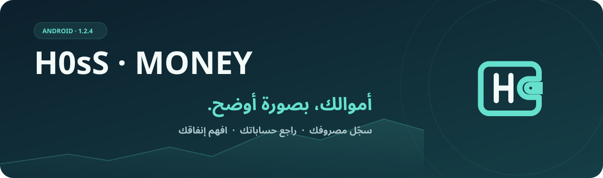
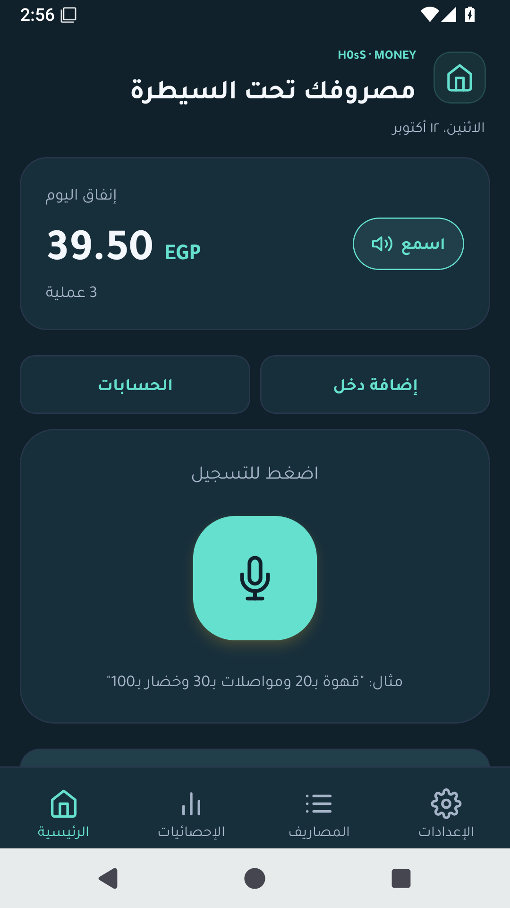
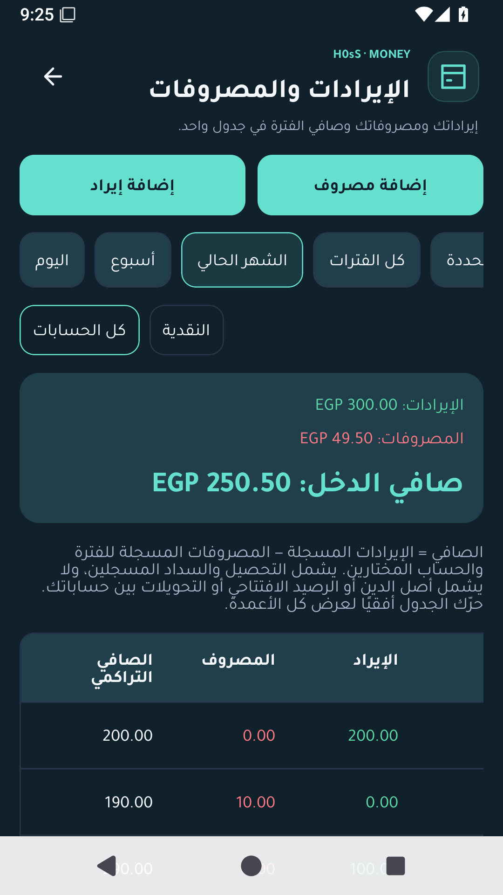
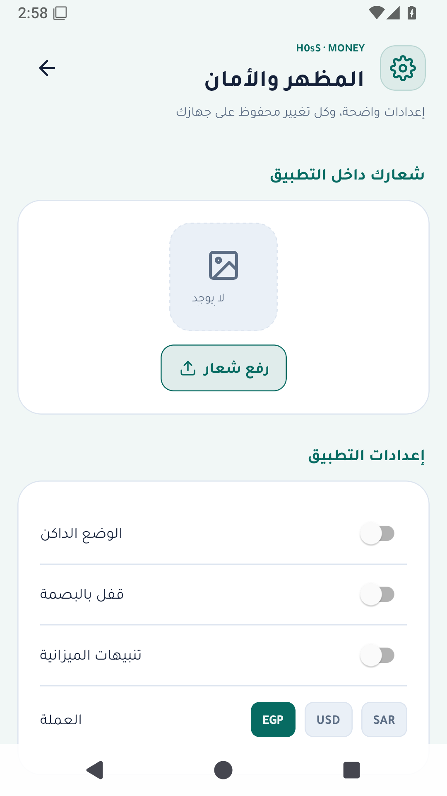
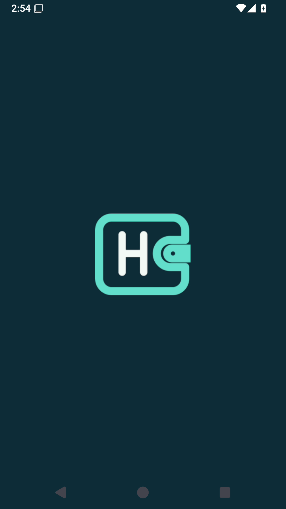

<div align="center">
  
  <br /><br />
  <strong>إدارة مالية يومية، بواجهة عربية واضحة.</strong>
  <p>سجّل مصروفاتك، تابع دخلك وحساباتك، وافهم أين تذهب أموالك.</p>
  <br /><br />
  <a href="#من-داخل-التطبيق">صور التطبيق</a> &nbsp; · &nbsp;
  <a href="#كل-ما-تحتاجه-لمتابعة-أموالك">الميزات</a> &nbsp; · &nbsp;
  <a href="#ابدأ-في-أربع-خطوات">البداية</a> &nbsp; · &nbsp;
  <a href="https://github.com/H0sSs/H0sS-Money/archive/refs/heads/main.zip">تحميل السورس</a>
  <p><sub>السورس 1.2.5 &nbsp; | &nbsp; Android 7+ &nbsp; | &nbsp; واجهة عربية &nbsp; | &nbsp; وضع فاتح وداكن</sub></p>
</div>

---

## الجديد في هذا الإصدار

- تقرير شامل متعدد الصفحات للفترة والحسابات والأقسام المختارة، مع معاينة وتصدير PDF وCSV.
- ملف شخصي للاسم والبيانات والصورة، وظهور اختياري في التقرير. اسم التطبيق ثابت.
- دليل استخدام عربي قابل للبحث من الإعدادات.
- فحص اتساق البيانات والتراجع الآمن عن آخر قائمة محفوظة من الرئيسية، وتحذير العمليات المتشابهة قبل حفظها.
- اختيار النموذج لكل مزود، وجلب قائمة Gemini بالمفتاح المحفوظ. الحصة ودعم الصوت يتحددان لدى المزود.
- حذف الفئة المطلوبة مع حفظ عملياتها القديمة في «أخرى».


## من داخل التطبيق

<table>
  <tr>
    <th align="center">الرئيسية والتسجيل</th>
    <th align="center">الإيرادات والمصروفات</th>
    <th align="center">المظهر والحماية</th>
  </tr>
  <tr>
    <td align="center"></td>
    <td align="center"></td>
    <td align="center"></td>
  </tr>
</table>

<p align="center"></p>

<sub>صور فعلية من الإصدار 1.2.5 على محاكي Android، باستخدام بيانات تجريبية.</sub>

## كل ما تحتاجه لمتابعة أموالك

### تسجيل أسهل، ومراجعة أوضح

سجّل المصروف والإيراد والدين والسداد في تسجيل صوتي واحد. يحدد التطبيق نوع كل بند، والعملية الملتبسة تحتاج مراجعتك قبل الحفظ. راجع أسعارها وفئاتها وحساباتها وتواريخها قبل حفظ القائمة، ثم عدّل وابحث وفلتر أو تراجع عن آخر حذف.

### حساباتك وإيراداتك في مكان واحد

افتح جدول **الإيرادات والمصروفات** لعرض الإيراد والمصروف في عمودين مستقلين، مع الصافي التراكمي وإجمالي الفترة. اختر الفترة والحساب. أنشئ حسابات بأرصدة افتتاحية، وسجّل الدخل والتحويلات بينها. تابع الديون والسداد الجزئي، وجهّز المصروفات الأسبوعية والشهرية المتكررة.

### أرقام تساعدك على فهم إنفاقك

اختر أسبوعًا أو 30 يومًا أو شهرًا تقويميًا أو فترة مخصصة. راجع توزيع الفئات ومقارنة الأشهر، وحدّد ميزانيات وهدفًا شهريًا مع تنبيهات الإنفاق. صدّر صورة للإحصائيات أو PDF عربيًا بتفاصيل العمليات والإيرادات والصافي.

### تجربة تناسبك وتحافظ على بياناتك

واجهة موحّدة بخط Tajawal العربي، مع بداية متناسقة للشعار والخلفية. اختر الوضع الفاتح أو الداكن وشعارك داخل التطبيق. فعّل قفل البصمة أو رمز الجهاز، واحتفظ بنسخة JSON أو اختر حساب Google الموجود على هاتفك لرفع نسخة يدويًا إلى Drive بعد تفعيل إعداد المشروع من مالك التطبيق.

## ابدأ في أربع خطوات

| الخطوة | ما تفعله |
| --- | --- |
| **01 · جهّز حسابك** | اختر العملة، وأضف حساباتك وفئات المصروفات من الإعدادات. |
| **02 · سجّل حركاتك** | أضف المصروفات والإيرادات، وراجع كل عملية قبل حفظها. |
| **03 · تابع الصورة كاملة** | افتح الإحصائيات، واختر الفترة، وصدّر التقرير المناسب. |
| **04 · احتفظ بنسخة** | صدّر بياناتك دوريًا من قسم النسخ والبيانات. |

## التسجيل الصوتي والذكاء الاصطناعي

من **الإعدادات ← الذكاء الاصطناعي**، أدخل مفتاح المزوّد واختر خدمة الصوت والتحليل.

| المزوّد | تحويل الصوت | تصنيف العمليات |
| --- | :---: | :---: |
| **Gemini** | ✓ | ✓ |
| **OpenAI** | ✓ | ✓ |
| **Z.ai · GLM-5** | عبر Gemini أو OpenAI | ✓ |

عند اختيار Gemini للصوت والتحليل معًا، يستخدم التسجيل **طلبًا واحدًا**. الصوت يحتاج الإنترنت ومفتاحًا صالحًا وحصة ووصولًا للنموذج لدى المزوّد. يستخدم هذا الإصدار `gemini-2.5-flash`؛ [Google تقصر عائلة 2.5 على المستخدمين الذين استخدموها سابقًا](https://ai.google.dev/gemini-api/docs/deprecations)، ولذلك المفتاح الجديد وحده لا يضمن الوصول. راجع النص والأصناف قبل الحفظ؛ نتائج الذكاء الاصطناعي قد تحتاج تصحيحًا أو إضافة صنف مفقود.

## التحميل والتحديث

**ARM64** أصغر حجمًا للأجهزة التي تدعم `arm64-v8a`. **النسخة الشاملة** تدعم أيضًا `armeabi-v7a` و`x86` و`x86_64`. النسختان تقدمان الميزات نفسها.

**الإصدار العام الحالي: 1.2.5 — بتوقيع خاص.**

| النسخة | الحجم | التحميل |
| --- | --- | --- |
| ARM64 | حوالي 32 MB | [تنزيل APK](https://github.com/H0sSs/H0sS-Money/releases/download/v1.2.5/H0sS-Money-1.2.5-arm64.apk) |
| الشاملة | حوالي 89 MB | [تنزيل APK](https://github.com/H0sSs/H0sS-Money/releases/download/v1.2.5/H0sS-Money-1.2.5-universal.apk) |

[صفحة الإصدار](https://github.com/H0sSs/H0sS-Money/releases/tag/v1.2.5) · [بصمات الملفات](https://github.com/H0sSs/H0sS-Money/releases/download/v1.2.5/SHA256SUMS.txt)

نسخ 1.2.2 والأقدم تستخدم شهادة تطوير عامة.

**الانتقال من 1.2.2 أو أقدم إلى التوقيع الخاص:** صدّر JSON واحفظه خارج التطبيق، ثم احذف النسخة القديمة وثبّت الجديدة واسترجع JSON. مفاتيح AI تحتاج إدخالها من جديد. التحديثات التالية بنفس التوقيع لا تتطلب حذف التطبيق.

[تفاصيل إصدار 1.2.5](docs/RELEASE-1.2.5.md) · [نتائج التحقق](docs/QA-1.2.5.md) · [عينة PDF فعلية](docs/report-sample-1.2.5.pdf)

<details>
<summary><strong>البيانات والخصوصية</strong></summary>

البيانات المالية محفوظة محليًا في SQLite. مفاتيح API محفوظة في SecureStore ولا تدخل في النسخ الاحتياطية. التسجيلات والنصوص تُرسل إلى مزوّد AI الذي تختاره، ونسخ Google Drive تُرفع عند طلبك.

الحسابات تستخدم عملة العرض نفسها دون تحويل أسعار صرف. التكرار التلقائي يُعالج عند فتح التطبيق أو العودة إليه.

</details>

<details>
<summary><strong>التطوير والمساهمة</strong></summary>

Expo SDK 54 · React Native 0.81.5 · TypeScript · SQLite.

```sh
npm ci --legacy-peer-deps
npm run check
npm run android
```

المتطلبات: Node.js 24 وJava 17 وAndroid SDK للبناء الأصلي. يحتفظ `scripts/rebundle-apks.py` بمكتبات وموارد APK المبني عند إجراء إصلاح JavaScript فقط، ويتطلب مفتاح التوقيع الخاص وإعداد نسختي APK صراحةً؛ لا يُستخدم لتغيير النسخة الأصلية أو إضافة مكتبات Native.

[إرشادات المساهمة](CONTRIBUTING.md) · [تفاصيل الإصدار](docs/RELEASE-1.2.5.md) · [مراجعة الاعتماديات](docs/DEPENDENCY-REVIEW.md) · [إعداد Google Drive والتوقيع](docs/GOOGLE-DRIVE-SETUP.md)

</details>

---

<div align="center"><sub>H0sS-Money · سجّل، راجع، وافهم إنفاقك.</sub></div>
